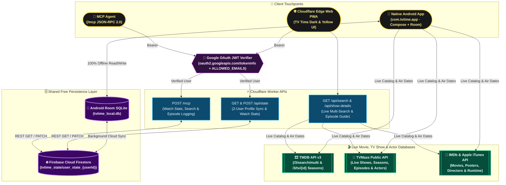

# 📺 TV Time: Show & Movie Tracker

An open-source, ad-free, paywall-free Android & Cloudflare Edge Web clone of **[TV Time: Show & Movie Tracker](https://apps.apple.com/us/app/tv-time-show-movie-tracker/id6792364354)** (`id6792364354`), built on the same multi-user **Android Room SQLite + Firebase Cloud Firestore + Cloudflare Workers + MCP Server** stack as [PackTrack](https://github.com/madhavsankar/PackTrack) and [PlacesTracker](https://github.com/madhavsankar/PlacesTracker).

---

## Features (1:1 Match with TV Time `id6792364354`)

- **3-Tab Bottom Navigation (`Home ⌂` · `Search 🔍` · `Profile 👤`):**
  - **🏠 Home Tab (`Shows` | `Movies` | `Upcoming`):**
    - **Shows Queue:** Filter by `Watch List`, `In progress`, or `Completed`, with collapsible *"Haven't started yet ∧"* divider, green progress bars, remaining episode counts (`3 episodes left · S02·E04`), and 1-tap yellow eye button (`👁`) to mark the next episode watched.
    - **Movies Queue:** Track movies in your Watch List vs. Completed, log rewatches (`↻`), and rate or react with emoji badges (`😍`, `🔥`, `🤯`).
    - **Upcoming Schedule (`Watchlist` | `Actors`):** Grouped by relative air-date dividers (`5 days`, `1 week`) with air-date pills (`Thursday 30th`) and lead actor chips.
    - **3D Shelf View (`⊞`):** Toggleable neon 3D shelf view displaying your Shows and Movies posters on wooden shelves.
  - **🔍 Search / Discover Tab:**
    - Live multi-search across **TMDB API v3** (`/3/search/multi` & `/3/tv/{id}`), **TVMaze Public API** (TV Shows, Seasons, Episodes, Air Dates & Actors), and **IMDb / Apple iTunes Search API** (Movies, High-Res Posters, Directors & Runtime).
    - Sort results by `Top`, `Newest`, or `Oldest` and add to your tracker with 1 tap (`+` → `✓`).
  - **👤 Profile & Watch Time Stats Tab:**
    - **TOTAL WATCH TIME Hero Card:** Displays cumulative watch time (`Xd Yh`) split across `Series · N eps` and `Movies · N`.
    - **Horizontal Poster Carousels:** `Favorite Shows`, `Recently Watched Series` (with `S02·E03` badges & emoji reactions), and `Recently Watched Movies`.
    - **Following Sheet (`Users` | `Actors`):** Follow favorite actors with 1-tap `IMDb` links, or view household profiles.
    - **Original TV Time Export Importer (`📥`):** *"Bring your original TV Time history over"* modal to import/export JSON backups directly on-device.
  - **📋 Show Detail Bottom Sheet (`Info` | `Episodes`):**
    - Expandable **Season Accordions** (`Season 1`, `Season 2`, ...) with 1-tap season-wide watch toggle and per-episode thumbnail rows (`1. Good News About Hell · Feb 18, 2022`).

---

## App Usage Pattern (Critical User Journey)

```mermaid
flowchart LR
    classDef userNode fill:#065f46,stroke:#10b981,stroke-width:2px,color:#ecfdf5,font-weight:bold
    classDef authNode fill:#1e1b4b,stroke:#818cf8,stroke-width:2px,color:#e0e7ff,font-weight:bold
    classDef screenNode fill:#18181b,stroke:#facc15,stroke-width:2px,color:#fef08a,font-weight:bold
    classDef catalogNode fill:#0c4a6e,stroke:#38bdf8,stroke-width:2px,color:#f0f9ff
    classDef dbNode fill:#3b0764,stroke:#c084fc,stroke-width:2.5px,color:#faf5ff,font-weight:bold

    Start(["👤 Open Web or Android App"]):::userNode --> Auth{{"🔐 Google Sign-In Gate\n(OAuth JWT + Allowlist)"}}:::authNode
    Auth -->|"Verified Email"| Home(["🏠 Home Queue\n(Shows | Movies | Upcoming + 3D Shelf)"]):::screenNode

    Home -->|"Tap 🔍 Search"| Search(["🔍 Multi-Search\n(TMDB v3 + TVMaze + iTunes)"]):::catalogNode
    Search -->|"Tap + or 👁"| Detail(["📋 Show / Movie Detail Sheet\n(Info | Season Accordions)" ]):::screenNode
    Home -->|"Tap 👁 Next Episode"| Firestore[("🗄️ Room SQLite &\nCloud Firestore DB")]:::dbNode
    Detail -->|"Toggle Episode / Season\nor Emoji Reaction"| Firestore
    Firestore --> Profile(["👤 Profile & Stats\n(Total Watch Time Xd Yh + Carousels)"]):::screenNode
```



---

## High-Level Design (Android & Cloudflare Worker Architecture)



---

## Quick Start

### 1. Native Android App (`android/`)

```bash
cd android
# Optional in git-ignored android/local.properties:
# FIREBASE_PROJECT_ID=your_firebase_project_id
# DEFAULT_USER_ID=your_username_or_email
# TMDB_READ_TOKEN=your_tmdb_read_token
./gradlew testDebugUnitTest assembleDebug
adb install -r app/build/outputs/apk/debug/app-debug.apk
```

### 2. Deploy Cloudflare Worker Web App (`cloudflare/`)

```bash
npx wrangler secret put FIREBASE_PROJECT_ID
npx wrangler secret put GOOGLE_CLIENT_ID
npx wrangler secret put ALLOWED_EMAILS
npx wrangler secret put TMDB_READ_TOKEN
npx wrangler secret put TMDB_API_KEY
npx wrangler deploy
```
*(Note: `keep_vars = true` is enabled in [`wrangler.toml`](wrangler.toml) so git pushes never overwrite variables or secrets configured in your Cloudflare Dashboard).*

### 3. Automated CI/CD & Firebase App Distribution (`.github/workflows/android-apk.yml`)

Every push builds the Android APK (`com.tvtime.app`) with an auto-incrementing `versionCode` (`1.0.<run_number>`) and automatically distributes it to the **`family`** tester group on **Firebase App Distribution** when the GitHub Actions secrets (`FIREBASE_ANDROID_APP_ID`, `FIREBASE_SERVICE_ACCOUNT_JSON`, `GOOGLE_CLIENT_ID`, `ALLOWED_EMAILS`, `GOOGLE_SERVICES_JSON`, `TMDB_READ_TOKEN`, `TMDB_API_KEY`, `ANDROID_KEYSTORE_BASE64`) are configured.

### 3. Run Unit Tests (`tests/`)

```bash
python3 -m unittest discover -s tests -v
```

---

## License

MIT
